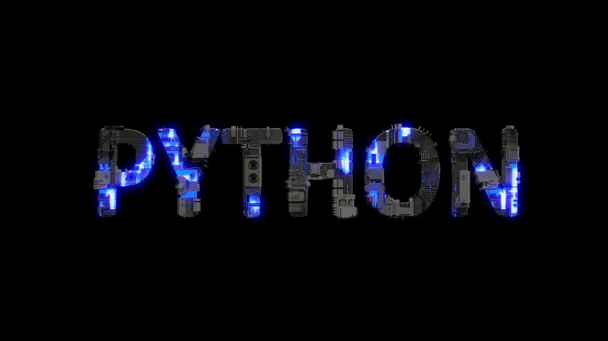

<div align="center">



<br><br>

# 🐍 Core Python

**Learn Python from scratch — clean examples, practice problems and notes, organised topic by topic.**

<p>
  
  
  
  
</p>

<p>
  
  
  
  
  
</p>

<p>
  
</p>

<p>
  <a href="#-quick-start">Quick Start</a> •
  <a href="#-topics-covered">Topics</a> •
  <a href="#-project-structure">Structure</a> •
  <a href="#-command-cheat-sheet">Commands</a> •
  <a href="#-contributing">Contributing</a> •
  <a href="#-license">License</a>
</p>

</div>

---

## 📖 About

**Core Python** is a beginner-friendly repository that covers the fundamentals of Python with small, runnable programs. Each topic has its own folder, so you can learn in order or jump straight to what you need.

- ✅ Simple, well-commented code
- ✅ Practice problems after every topic
- ✅ Works on Windows, macOS and Linux
- ✅ No external libraries needed for the core lessons

> ⭐ If this repository helps you, please **star** it. It helps other learners find it too.

---

## 🚀 Quick Start

Get running in under a minute.

### 1. Clone the repository

```bash
git clone https://github.com/yashsdhinoja/Core-Python.git
```

### 2. Move into the project folder

```bash
cd Core-Python
```

### 3. (Recommended) Create a virtual environment

<details>
<summary><b>🪟 Windows</b></summary>

```powershell
python -m venv venv
venv\Scripts\activate
```

</details>

<details>
<summary><b>🍎 macOS / 🐧 Linux</b></summary>

```bash
python3 -m venv venv
source venv/bin/activate
```

</details>

### 4. Run any program

```bash
python 01-basics/hello_world.py
```

> 💡 Replace the path with any `.py` file from the repository.

---

## 📚 Topics Covered

| # | Topic | What you will learn | Level |
|---|-------|--------------------|-------|
| 01 | **Basics** | Variables, data types, input/output, operators | 🟢 Beginner |
| 02 | **Control Flow** | `if / elif / else`, loops, `break`, `continue` | 🟢 Beginner |
| 03 | **Data Structures** | Lists, tuples, sets, dictionaries, comprehensions | 🟢 Beginner |
| 04 | **Functions** | Arguments, `*args / **kwargs`, lambda, recursion | 🟡 Intermediate |
| 05 | **OOP** | Classes, inheritance, polymorphism, dunder methods | 🟡 Intermediate |
| 06 | **File Handling** | Read/write files, CSV, JSON | 🟡 Intermediate |
| 07 | **Exceptions** | `try / except / finally`, custom exceptions | 🟡 Intermediate |
| 08 | **Modules & Packages** | Imports, standard library, `pip` | 🟡 Intermediate |
| 09 | **Advanced** | Decorators, generators, iterators, context managers | 🔴 Advanced |

> 📌 Edit this table so it matches the folders you have actually uploaded.

---

## 📂 Project Structure

```bash
Core-Python/
├── 01-basics/            # variables, types, operators
├── 02-control-flow/      # conditions and loops
├── 03-data-structures/   # list, tuple, set, dict
├── 04-functions/         # functions, lambda, recursion
├── 05-oop/               # classes and objects
├── 06-file-handling/     # files, CSV, JSON
├── 07-exceptions/        # error handling
├── 08-modules/           # modules and packages
├── 09-advanced/          # decorators, generators
├── practice/             # exercises and solutions
├── LICENSE
└── README.md
```

---

## 🧪 Example

```python
# 01-basics/hello_world.py
name = input("Enter your name: ")
print(f"Hello, {name}! Welcome to Core Python 🐍")
```

**Output**

```text
Enter your name: Yash
Hello, Yash! Welcome to Core Python 🐍
```

---

## 💻 Command Cheat Sheet

### 🐍 Python

| Task | Command |
|------|---------|
| Check Python version | `python --version` |
| Run a script | `python file_name.py` |
| Open interactive shell | `python` |
| Run a module | `python -m module_name` |
| Run all tests (if added) | `python -m unittest discover` |

### 📦 pip

| Task | Command |
|------|---------|
| Install a package | `pip install package_name` |
| Install from file | `pip install -r requirements.txt` |
| Save installed packages | `pip freeze > requirements.txt` |
| List packages | `pip list` |
| Upgrade pip | `python -m pip install --upgrade pip` |

### 🌱 Virtual environment

| Task | Windows | macOS / Linux |
|------|---------|---------------|
| Create | `python -m venv venv` | `python3 -m venv venv` |
| Activate | `venv\Scripts\activate` | `source venv/bin/activate` |
| Deactivate | `deactivate` | `deactivate` |

### 🔧 Git

| Task | Command |
|------|---------|
| Get latest changes | `git pull origin main` |
| Create a branch | `git checkout -b feature/your-feature` |
| Stage all changes | `git add .` |
| Commit | `git commit -m "feat: add your change"` |
| Push | `git push origin feature/your-feature` |

---

## 🗺️ Learning Roadmap

- [x] Python basics
- [x] Control flow
- [x] Data structures
- [ ] Functions & recursion
- [ ] Object-oriented programming
- [ ] File handling
- [ ] Exceptions
- [ ] Modules & packages
- [ ] Decorators & generators
- [ ] Mini projects (calculator, to-do app, quiz game)

---

## 🤝 Contributing

Contributions, issues and feature requests are welcome!

1. **Fork** this repository
2. **Create** a branch: `git checkout -b feature/AmazingFeature`
3. **Commit** your changes: `git commit -m "feat: add AmazingFeature"`
4. **Push** to your branch: `git push origin feature/AmazingFeature`
5. **Open** a Pull Request

| Commit prefix | Use for |
|---------------|---------|
| `feat:` | New program or topic |
| `fix:` | Bug fix in an example |
| `docs:` | README or notes changes |
| `refactor:` | Cleaner code, same behaviour |

Found a problem? [Open an issue](https://github.com/yashsdhinoja/Core-Python/issues).

---

## 📜 License

Distributed under the **MIT License**. See [`LICENSE`](LICENSE) for details.

---

## ⭐ Star History

<a href="https://star-history.com/#yashsdhinoja/Core-Python&Date">
  
</a>

---

## 🏆 Contributors

<a href="https://github.com/yashsdhinoja/Core-Python/graphs/contributors">
  
</a>

---

## 📬 Connect With Me

| Platform | Link |
|----------|------|
| GitHub | [@yashsdhinoja](https://github.com/yashsdhinoja) |
| LinkedIn | [Add your LinkedIn link](https://linkedin.com) |

<div align="center">

### Happy coding! 🐍

Made with ❤️ by [Yash](https://github.com/yashsdhinoja)

</div>